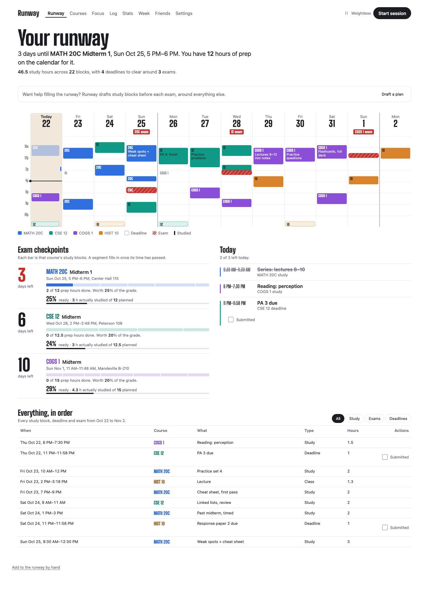
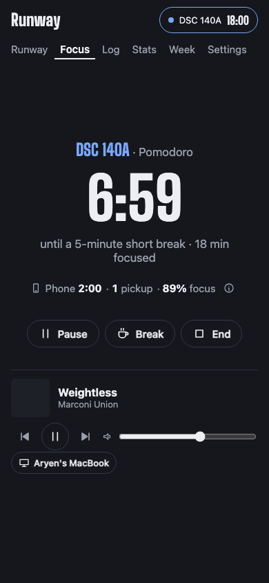
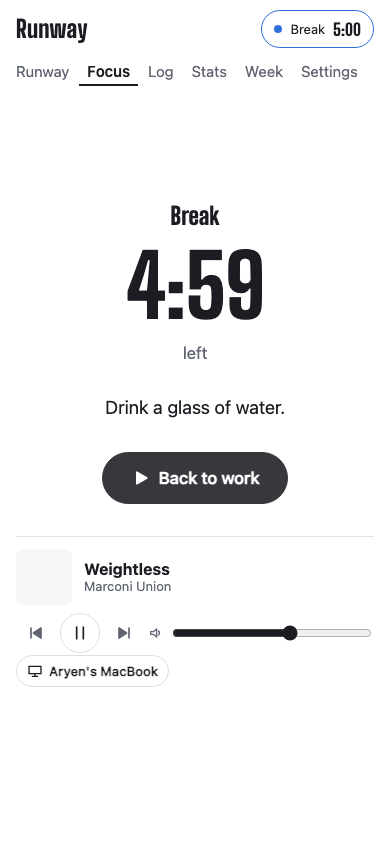
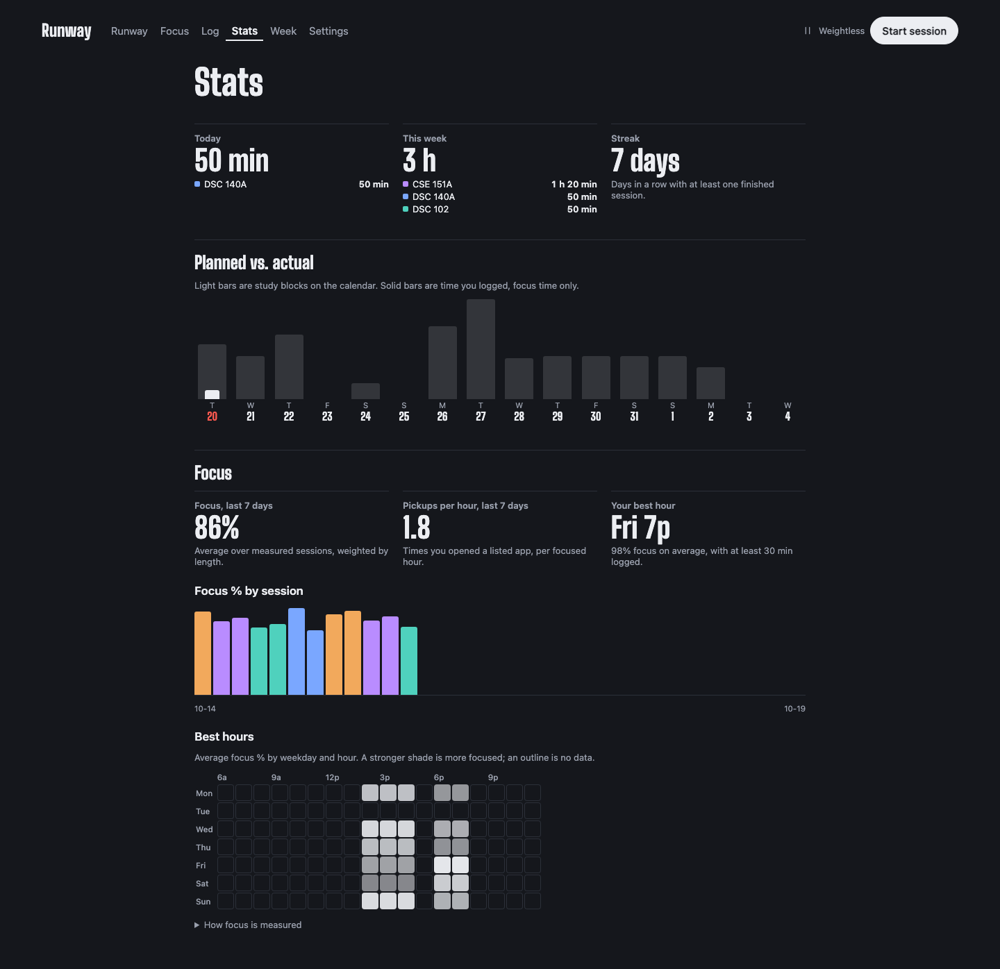

# Runway

Runway is a study app for students. Sign up with your school email, connect your calendar (Canvas, Google, iCloud, Outlook or an .ics file), check how Runway read it, run your study sessions with breaks and music, check your focus with your phone, and see how ready you actually are for each exam. It started as my own study cockpit built from my Google Calendar; v2 makes it something anyone can use.

**Live:** https://aryenp.github.io/academic-dashbaord/



## Why I built it

Every study app I tried owned one slice. Forest and Opal keep you off your phone. Flocus and LifeAt are nice rooms to sit in. Rize measures your time. YPT has leaderboards. None of them knew what I was supposed to be studying, or when my exams were, so none could tell me whether I was on track.

Runway starts from the plan I already keep and closes the loop: **plan → session → verified focus → exam readiness**. "Planned vs. actual" comes for free, because the plan is the calendar.

## What it does

- **Runway.** Every day from now to the last exam, 8 AM to midnight, with study blocks in course colors and exams hatched in red. Time I actually studied is drawn as a thin bar beside the plan. Each exam shows a countdown and a readiness score: hours studied for that course before the exam ÷ hours planned.
- **Sessions.** One tap starts a session on whatever the calendar says I should be doing now. The timer is derived from timestamps in the database, never ticked, so it's right after a reload, after the laptop sleeps, and on my phone and laptop at the same time.
- **Breaks.** Pomodoro, 50/10, custom, or flow (no timer, a nudge at 90 minutes). The break screen gives one concrete thing to do: water, stretch, the 20-20-20 eye rule.
- **Phone focus.** iPhone Shortcuts automations ping Runway when I open or close an app I've marked as distracting. During a session that becomes phone time, pickups, and focus % = 1 − phone time ÷ focus time. Breaks don't count.
- **Music.** Spotify follows the session: the focus playlist on start, the break playlist on breaks, pause at the end. It remote-controls the Spotify app already running on my phone or laptop.
- **Log, stats, weekly review.** Every session, editable, with manual entries and CSV export. Planned vs. actual per day, focus % over time, pickups per hour, and a heatmap of my best hours.
- **Works offline.** It installs to the Home Screen. A whole session works without a connection, then syncs with the right times when it's back.

| Focus | Break | Stats |
| --- | --- | --- |
|  |  |  |

## How it works

```
Canvas / Google / iCloud / Outlook feeds ──▶ Edge Function sync-sources ──▶ Supabase Postgres ◀── the site (GitHub Pages)
            (every 15 min, GitHub Actions; addresses in Vault)              (Row Level Security)
iPhone Shortcuts ──POST──▶ Edge Function phone-event ───────────────────────▶
Spotify app on phone/laptop ◀── Web API (PKCE) ── the site
```

- **Frontend:** Vite, React, TypeScript, hash routing. The runway's design carried over from the first version: Big Shoulders Display for numbers, course colors, theme-following light and dark.
- **Plan:** per account, in `courses` and `plan_items` (study blocks, deadlines, exams, classes, commitments), drawn in your timezone. They come from the calendars you connect: the `sync-sources` Edge Function fetches each feed every 15 minutes (addresses are stored encrypted in Supabase Vault), expands recurring events, reads titles with the course-code rules, and keeps the plan in step. Events the rules were unsure about go to Claude (`classify-events`, server-side, titles and times only, metered per person per month); the Courses screen shows every reading and lets you fix it, and your fix wins over the AI, which wins over the rules. The landing page draws a demo plan with made-up courses.
- **Backend:** Supabase. Every table has Row Level Security; sign-up needs a school email; sharing is off by default, and visitors to a share page can call exactly four functions that return nothing unless that person turned sharing on. Session state changes are SQL functions, so the web app and the phone go through the same code. Deleting your account deletes everything.
- **Phone:** a personal token (only its hash is stored), rate-limited to 120 requests a minute. Shortcuts can't read Screen Time, and a website can't either, so this is the honest version: it sees only the apps I list.
- **Spotify:** Authorization Code with PKCE and the player endpoints. No Web Playback SDK; it's been unreliable for Development Mode apps since March 2026 (see `docs/RESEARCH.md`).

Design decisions and the reasons for each are in [`docs/DECISIONS.md`](docs/DECISIONS.md). The spec is [`docs/SPEC.md`](docs/SPEC.md).

## Tests

- **Unit** (Vitest): the timer, the focus formula, stats, the offline queue, the Spotify client.
- **Database** (Vitest against a local Supabase): RLS. Another account can't read or change your rows; share pages get only what you turned on; sign-up needs a school email; deleting an account removes everything.
- **Edge Functions** (Deno): the iCal parser and recurrence expansion, the title rules, the sync against a fake database (first sync, 304, a renamed event, a deleted event, an override, duplicates across sources, errors), the Claude call against a fake API (request shape, caching, parsing, refusals, pricing), and the phone-event handler.
- **Eval** (`npm run eval:classify`): a labeled set of 48 calendar events; scores the title rules, and Claude with `--ai`.
- **Browser** (Playwright): the landing page, sign-in and privacy pages, plus signed-in flows against a local Supabase with Spotify faked at the network layer: connecting a calendar (served from the test), the Courses review screen, sessions, breaks, phone tracking, sharing, offline sync, and an axe accessibility check of every view in light and dark.

Lighthouse on mobile: 96 performance, 100 accessibility.

## Run it yourself

```sh
npm install
npm run dev          # http://127.0.0.1:5173/academic-dashbaord/  (landing page only, no backend needed)
npm run check        # lint, format, unit tests, build (with the prerendered landing page), browser tests
```

With the backend (needs Docker and the Supabase CLI):

```sh
supabase start                          # local Postgres, Auth, Realtime
echo 'SYNC_KEY=local' > .env.functions.local && supabase functions serve --no-verify-jwt --env-file .env.functions.local
# put the local URL and anon key in .env.local as VITE_SUPABASE_URL and VITE_SUPABASE_ANON_KEY
npm run test:db && npm run test:fn && npm run test:e2e:db
```

### Deploying your own

1. **Supabase.** Create a free project and run `supabase link` and `supabase db push`, then `supabase functions deploy phone-event sync-sources --no-verify-jwt` and `supabase functions deploy validate-source`. Deploy `classify-events` too. Pick a random `SYNC_KEY`, set it with `supabase secrets set SYNC_KEY=…` and as a repo secret, set `ANTHROPIC_API_KEY` the same way for the AI reading (optional: without it the title rules do all the reading), and add `SUPABASE_URL` and `SUPABASE_ANON_KEY` as repo secrets. Under Authentication → URL Configuration, set the Site URL to your Pages URL.
2. **Pages.** Settings → Pages → Source: GitHub Actions.
3. **Google sign-in (optional).** Add a Google OAuth client under Authentication → Providers and build with `VITE_GOOGLE_SIGNIN=true`.
4. **Spotify (optional, needs Premium).** Create an app at developer.spotify.com with the redirect URIs `https://<you>.github.io/academic-dashbaord/spotify.html` and `http://127.0.0.1:5173/academic-dashbaord/spotify.html`, and add its Client ID as the repo secret `SPOTIFY_CLIENT_ID`.
5. **iPhone.** Make a token in Settings → Phone and follow the setup guide it links to.
